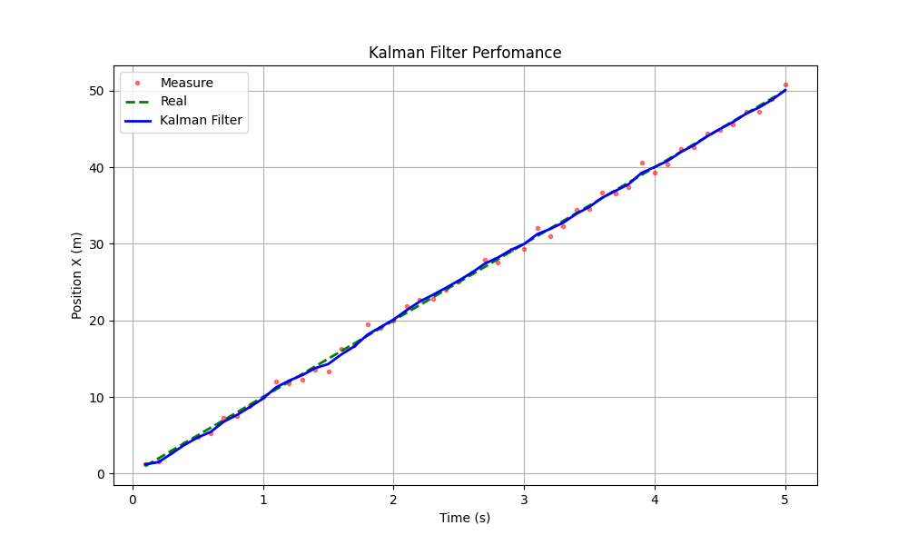

# Kalman-High-Perfomance_filter (C++)
A C++ Implementation of a Kalman Filter built from scratch, designed for low-latency estimation.


*Figure 1: Kalman Filter (Blue) successfully reconstructing the true trajectory (Green) from noisy sensor data (Red).*

## Key Features

* **Linear Algebra Engine:** *Implemented a Matrix class using 1D `std::vector` for **Cache Locality** and contiguous memory.
    * No use of `vector<vector>` overhead to minimize cache misses during matrix multiplications.
* **Optmized Math Kernels:**
    * Implemented **Gauss-Jordan Elimination**
    * Apllied **Reciprocal Multiplication** optmization to replace costly division operations in the inner loops.
* **Monte Carlo Simulation:**
    * Includes a physics engine to simulate particle kinematics with Gaussian noise, validating the filter's performance.

## Tech Specs
* **Core:** C++ 17
* **Build System:** GNU Compiler Collection
* **Visualization:** Python (Pandas & Matplotlib)

## How it Works
1. **Prediction (Time Update):** Projects the state foward using Newtonian laws.
2. **Correction (Measurement Update):** Fuses the sensor data ($z$) using the optimal **Kalman Gain** ($K$), minimizing the error of the covariance ($P$).

## Quick Start
### 1. Build the Engine
```bash
g++ src/core/Matrix.cpp src/physics/Particle.cpp src/physics/KalmanFilter.cpp -o kalman
```
### 2. Run the Simulation
Generates the *results.csv*
```bash
./kalman
```
### 3. Visualize Results
```bash
python3 graphs.py
```

## Notes
* Priorization of **memory contiguity** by using a row-major 1D layout

